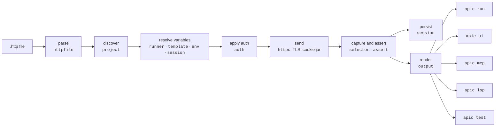

# Architecture

How a request flows through apic, which crate does what, and the three
contracts that every change is checked against. Read this before
changing the runner or adding a directive; the last lesson of
[the course](https://apic.sh/learn/) walks the same ground with a keyboard.

## The lifecycle of a request

1. **Parse** (`crates/httpfile`). A file is split on `###` into blocks;
   each block's comments become directives (`# @name`, `# @assert`,
   `# @capture`, …), then the request line, headers and body are read.
   The parser never fails outright: problems become diagnostics with a
   line, a span and a code, and every request it could read is still
   there. Multipart bodies are read into parts on demand; `apic fmt`
   works from the same regular expressions so the canonical form and the
   parser cannot disagree.
2. **Discover** (`crates/project`). The project root holds `apic.yaml`,
   the env files and `.apic/`; every `*.http` and `*.rest` under it (or
   under `dir:`) is parsed and indexed by name and by `file#N`.
   `validate` adds the project-level checks: duplicate names, unknown
   selectors, bad auth specs, `# @ref` cycles, missing body files.
3. **Resolve** (`crates/runner`, `template`, `env`, `session`). Every
   `{{placeholder}}` in the URL, headers, body and auth spec is looked up
   in a fixed order: `--var` and `APIC_VAR_*`, values captured in this
   run, the session, the private env file, the public env file, `.env`,
   file `@vars`, then the built-ins (`$uuid`, `$timestamp`, …) and
   `{{name.response.…}}` references. `describe` reports the source of
   each. A missing value stops the request here with exit 2, unless a
   `# @ref` names the request that captures it, which runs first.
4. **Apply auth** (`crates/auth`). `# @auth` (or `auth.default`) is
   parsed into a spec and applied to the outgoing request: a bearer or
   basic header, an AWS SigV4 signature from apic's own signer, an OAuth2
   token fetched and cached in the session, or the output of a command.
   Credentials are set on the wire and never appear in output.
5. **Send** (`crates/httpc`). One attempt per `# @retry` round, with the
   request's timeout, the TLS settings for its host and the cookie jar
   when it is on. Redirects drop credential headers when they leave the
   host. A transport failure is exit 3.
6. **Capture and assert** (`crates/selector`, `crates/assert`). The
   response is read once, bounded by `maxBodyBytes`; `# @capture`
   selectors pull values out of it and `# @assert` expressions are
   evaluated. A failed assertion or capture is exit 1.
7. **Persist** (`crates/session`, `crates/history`). Captures are
   committed to the run and to `.apic/session.json` for the environment,
   and the cookie jar to `.apic/cookies.json`, so the next invocation
   continues where this one stopped. With `history:` set, the result is
   also kept in `.apic/history`, in its `--json` form, for `apic history`.
8. **Render** (`crates/output`). One set of renderers produces the
   terminal report, the `--json` line, the UI panes and the MCP result,
   all from the same `Result`, with the same redaction rules.

## The three contracts

| Contract | Where it is enforced |
|---|---|
| **The `.http` dialect** stays what VS Code REST Client and JetBrains send. Everything apic adds is a `# @directive` comment. | `crates/httpfile/testdata/sample.http` (the golden parse), `grammar_matches_known_directives` (the VS Code grammar lists every directive the parser knows), `apic validate` warning on unknown directives rather than failing. |
| **`--json` and exit codes** are stable: keys are only added, and 0/1/2/3 keep their meanings. | The runner's errors are an enum and `exit_code` is a `match` on it, so a transport error wrapped in context cannot turn a 3 into a 2, and a new variant does not compile without a code; `exit_code_unwraps`; the JSON shapes in `crates/runner` are typed and the VS Code extension reads them from `types.ts`. Error codes (E101…) come from the runner's catalogue, which also generates the site's [errors.md](../website/src/content/docs/errors.md); `every_code_is_produced` runs a real command for each. |
| **Every command is non-interactive** and honours `--json`; `apic ui` is the one exception and exits 2 without a terminal. | `apic test` and the CLI tests run with no TTY; device-code and exec prompts write to stderr and never block on stdin. |

## Crates

Each is a directory under `crates/`, a package named `apic-<name>` with
the library `apic_<name>`; a file named below is under its `src/`.

- `crates/apic`: entry point, the `apic` binary
- `crates/httpfile`: `.http` parser (AST in `ast.rs`, parser in `parse.rs`, multipart bodies in `multipart.rs`, the formatter in `format.rs`, golden file in `testdata/`)
- `crates/project`: file discovery, `apic.yaml`, request lookup, `validate`
- `crates/suggest`: the "did you mean" ranking (prefix, substring, then edit distance) behind an unknown request or environment name; dependency-free so `project` and `runner` can both use it
- `crates/env`: `http-client.env.json`, private env file, `.env`, the JetBrains `SSLConfiguration` block
- `crates/template`: `{{placeholder}}` substitution
- `crates/selector`: `status`, `header.x`, `cookie.x`, `body.$.path` selectors
- `crates/assert`: assertion parser and evaluator
- `crates/session`: persistence of captured values and cached tokens in the project's `.apic/` directory, and the cookie jar in `cookies.rs`
- `crates/history`: the last N responses of each named request per environment in `.apic/history`, and the comparison `apic history diff` and the UI's history tab show (JSON by structure, text by line)
- `crates/auth`: `# @auth` spec parsing and application for bearer, basic, AWS SigV4 (own signer in `sigv4.rs`, credentials in `awscreds.rs`; no AWS SDK), OAuth2 grants and exec
- `crates/runner`: variable precedence, request execution, TLS settings (`tls.rs`), captures, asserts, retries, `# @ref` dependencies, flows, `describe`
- `crates/output`: the shared theme (`theme.rs`, on apic's own small ANSI style module), the string renderers used by both the CLI and the UI (`render.rs`), JSON highlighting (`jsonhl.rs`) and the writer wrappers (`output.rs`)
- `crates/httpc`: the HTTP client, hyper and rustls behind apic's own connector, so the per-phase timings, the proxies (SOCKS5 included) and mutual TLS are apic's own code. TLS is rustls with the `ring` provider and the system's roots through `rustls-native-certs`
- `crates/httpd`: the small HTTP server and router behind `apic demo`, `apic mock` and the tests' local servers
- `crates/gocompat`: the text formats the output contract fixes: durations, quoted strings and floats
- `crates/phrase`: `# @step` phrase to regex
- `crates/bdd`: the `apic test` machinery. Feature files are parsed by the `gherkin` crate and run by apic's own scenario runner: step vocabulary (`steps.rs`), phrase registration, JSON matching, the cucumber-JSON report and its summary
- `crates/lsp`: `apic lsp`, the language server. JSON-RPC 2.0 with the protocol's framing is written out in `jsonrpc.rs` rather than taken from a library; diagnostics come from the project crate's `load_overlay` and `validate` over the open buffers, hover from `describe`, so an editor sees exactly what the CLI would report
- `crates/snippet`, `crates/curlimport`, `crates/openapi`, `crates/postman`, `crates/mcp`: the `curl`/`snippet`, `import`, `mock` and `mcp` commands. The MCP server is hand-written JSON-RPC, like the language server, with no SDK. The OpenAPI reader is a small walker over the parsed YAML (`model.rs`) with local `$ref` resolution and the Postman reader a hand-written model; neither uses a library for its format. `openapi/src/mock.rs` serves the same document as a stateless mock for `apic mock`: the response walker reuses the example builder `import` uses for request bodies, and the routes are `httpd` router patterns, so it adds no dependency
- `crates/cli`: the `clap` commands (builder API, completions from `clap_complete`), including `demo`, `mock` (the two local servers share `serve.rs`), `init`, `fmt` and `ui`
- `crates/ui`: the `apic ui` terminal UI. Model/update/view live in `ui.rs`, `list.rs`, `panes.rs` and `run.rs`, key bindings in `keys.rs`, and its own small terminal layer in `term.rs` (input decoding), `viewport.rs` and `program.rs` (event loop). Tests drive `update`/`view` directly, so no terminal is needed
- `crates/demoapi`: fake in-memory API (auth, API key, a todos CRUD resource with filtering and validation, polled jobs, multipart upload, GraphQL, a CSV report, a slow route, health; the route list is on `new`) and its embedded example project (`project/`), backing the `apic demo` command and its test suite. Every route exists so a lesson or a guide has something offline to run against; keep the project's requests and `features/todos.feature` in step with it
- `examples/`: static sample projects, each `apic validate`-checked and `apic fmt --check`-ed in CI. `httpbin` (basic/bearer auth, needs network but no keys), `github` (bearer auth against a real token), `spotify` (`oauth2` client-credentials against a real app); the last two need the reader's own credentials in their `http-client.private.env.json`
- `editors/vscode/`: the VS Code extension, TypeScript bundled with esbuild, a thin client over the binary's `--json` contract (it never parses `.http` files itself). It injects a grammar for `# @directive` lines into the `http` language REST Client provides rather than owning the language, and bundles the JSON schemas. Released on its own `vscode-v*` tags
- `setup-apic/`: the composite GitHub Action (`uses: hungovercoders/apic-rust/setup-apic@v0`) that installs a release with the same checksum verification as `install.sh`, on all three runner OSes
- `skills/`: the pack of [Agent Skills](https://agentskills.io) an agent loads on demand, one directory each, embedded by `crates/skills` (with `include_dir`) so `apic skill [name]` prints one and `apic skill install` and `apic init` write them all into a project. `skills/apic/` is how to use apic (`SKILL.md`, hand-written: the workflow, the JSON contract, the error codes, how to write a request; `references/cheatsheet.md` is the site's `cheatsheet.md` with absolute links, generated by `scripts/skilldocs`, `task skill`, with a test that fails when it is stale; `evals/` holds the tasks `scripts/agenteval`, `task agent:eval`, runs through the Claude Code CLI to score how an agent fares with and without the skill). `skills/api-design/` is how to design the API the requests call and `skills/api-security/` how to keep it safe and prove it, both hand-written with their references, both tying every rule to a request or scenario apic runs, and each with its own `evals/` (the `apic` skill is installed by default; these two by `--all` or `--skill`, being opinions about the reader's API). The same test checks every skill's front matter (the name is its directory), its body length, that its `references/` links resolve inside the skill, and that no `apic <word>` it names is not a command
- `website/`: [apic.sh](https://apic.sh/), the user documentation, an Astro site with Starlight; the pages are `src/content/docs/`, with the course under `learn/` (one page per lesson whose marked blocks `scripts/learncheck` runs in CI) and the migration guides under `migrate/`. The screenshots under `public/assets/` are generated from real output by `scripts/shot`; `scripts/schemas` generates the JSON schemas for `apic.yaml`, the env files and the session file into `public/schemas` and `editors/vscode/schemas`; `scripts/clidocs` generates the "Commands and flags" section of `cli.md` and the man pages from the command tree; `scripts/errdocs` generates `errors.md` from the catalogue
- `docs/`: this page, the lesson and episode templates, the VHS tapes and the Vale styles: reference for working on apic rather than using it

## How to add things

Each of these is a checklist the tests enforce, so a missing step fails
`task check` rather than shipping.

**A directive** (`# @thing value`):

1. Read it in `crates/httpfile` (`ast.rs` for a typed accessor, or
   `Request::directive("thing")`), and add it to `KNOWN_DIRECTIVES` in
   `parse.rs`; a case in `testdata/sample.http`.
2. Add it to the alternation in
   `editors/vscode/syntaxes/apic-directives.injection.json`;
   `grammar_matches_known_directives` fails otherwise.
3. Give it a rank in `directive_rank` in `format.rs` if it has a natural
   place in the canonical order.
4. Act on it in `crates/runner` (or `crates/cli`), with a test beside
   the change; a `validate` check with a code in `httpfile`'s code table if it
   can be wrong.
5. Document it in the directive table of `format.md`, in `cheatsheet.md`,
   and in the codes table of `cli.md` when it has a code.

**A Gherkin step**: its regex and shapes in `crates/phrase/src/builtin.rs`,
a handler bound by name in `crates/bdd/src/steps.rs`, a row in
the `bdd` crate's vocabulary, a scenario in its tests, and the table in
`testing.md`.

**A command**: a `clap` command in `crates/cli` (one file per command)
that respects `--json`, a row in the README table, a section in `cli.md`,
a line in `cheatsheet.md`, and `task docs:cli` to regenerate the flags
reference at the end of `cli.md` and the man pages (`scripts/clidocs`;
its staleness test fails otherwise).

**An `apic.yaml` key**: a field on the project crate's `Config`, a description in
`scripts/schemas/src/main.rs`, and `task schemas` to regenerate the schemas
(their staleness test fails otherwise).

The repository's own conventions for tests, linting, licensing and
releasing are in
[AGENTS.md](https://github.com/hungovercoders/apic-rust/blob/main/AGENTS.md)
and [CONTRIBUTING.md](https://github.com/hungovercoders/apic-rust/blob/main/CONTRIBUTING.md).
